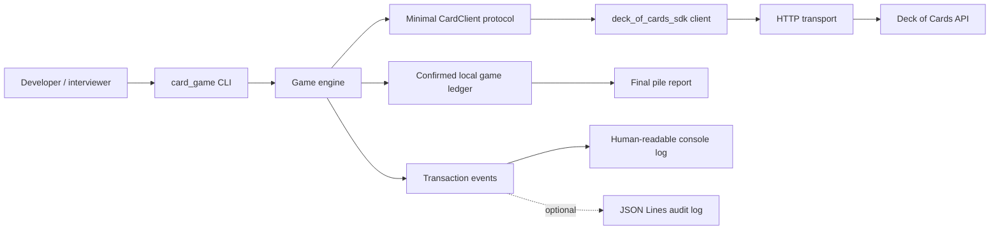
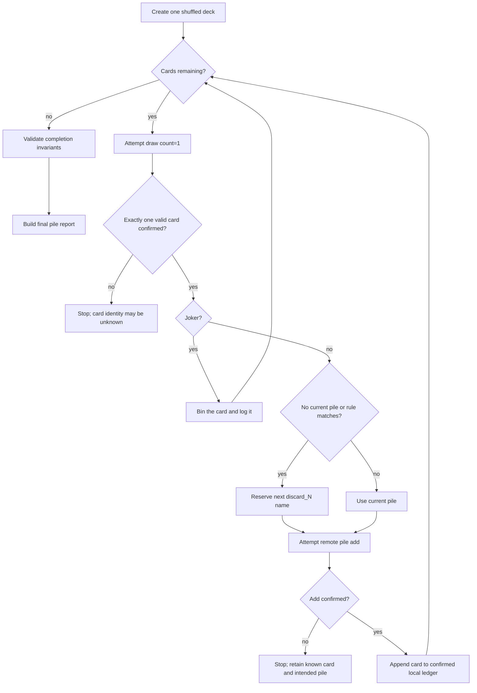

# Architecture

## Status and goals

- Status: implementation baseline
- Last reviewed: 2026-11-09
- Code status: in progress; see [implementation-plan.md](implementation-plan.md)
- Requirements: see [requirements.md](requirements.md)

The design has two primary goals:

1. expose a useful Deck of Cards API SDK with no knowledge of this game; and
2. keep the King-triggered rule small, deterministic, and easy to change in an
   interview.

The architecture deliberately avoids a framework, database, server, container,
and cloud deployment. They would add operational concepts without solving a
requirement of this short-lived command-line application.

## System context



Dependency direction is left-to-right through public interfaces. The CLI
constructs dependencies but contains no pile-selection rules. The SDK knows
nothing about Kings, discard piles, or game completion.

## Component responsibilities

### SDK package: `deck_of_cards_sdk`

| Module | Responsibility |
| --- | --- |
| `client.py` | Public `DeckOfCardsClient` operations and endpoint-specific parameter construction |
| `models.py` | Immutable typed cards, deck state, pile state, and parsed operation results |
| `transport.py` | One place for HTTPS requests, timeout handling, HTTP status handling and JSON decoding, with no automatic retries |
| `validation.py` | Deck ID, pile name, count, deck count, card code, and option validation |
| `exceptions.py` | Stable SDK exception hierarchy that does not leak `httpx` as the public contract |
| `__init__.py` | Small, intentional public API |

The client is synchronous because the game performs one operation at a time and
has no concurrent workload. An asynchronous interface would increase concepts
and testing cost without improving this use case.

Planned public operations:

- create ordered or shuffled decks;
- configure deck count;
- create partial decks;
- request the documented Joker option;
- draw one or more cards;
- reshuffle all cards or only remaining cards;
- add cards to a pile;
- shuffle and list a pile;
- draw from a pile by top, bottom, random, or explicit card code;
- return all or selected cards from drawn state or a pile.

### Game/domain package: `card_game`

| Module | Responsibility |
| --- | --- |
| `engine.py` | Orchestrate draw, rule decision, remote pile add, state transition, completion checks, and `GameInterruptedError` |
| `models.py` | Confirmed discard piles and the final game result |
| `ports.py` | Minimal client `Protocol` required by the engine, enabling a deterministic fake |
| `rules.py` | The game rules: `should_start_new_pile(card)` (a King) and `should_bin_card(card)` (a Joker) |
| `events.py` | Typed transaction event names and context creation |
| `cli.py` | Parse options, configure logging, run the engine, render summaries, and map failures to exit codes |
| `__main__.py` | `python -m card_game` entry point only |

The game consumes stable public card/deck models from the SDK but does not
import SDK transport internals. `ports.py` narrows the dependency to only:

1. create one shuffled deck;
2. draw cards; and
3. add cards to a pile.

A test fake can satisfy this protocol without inheriting from the concrete SDK
client.

### CLI/presentation

The CLI is a composition root and renderer. It may show:

- game and deck initialisation;
- face-down progress such as `Card 17/52 -> discard_2 [face down]`;
- a binned Joker, such as `Card 17/54 -> binned (Joker)`;
- confirmed pile creation;
- completion or interruption;
- a final text table of pile name, bottom card, top card, and count, plus the
  number of Jokers binned.

It does not decide when to create piles or mutate game state directly.

## Planned repository layout

```text
.
├── .github/
│   └── workflows/
│       └── ci.yml
├── docs/
│   ├── architecture.md
│   ├── implementation-plan.md
│   ├── interview-guide.md
│   ├── prompt-sheet.md
│   └── requirements.md
├── src/
│   ├── card_game/
│   │   ├── __init__.py
│   │   ├── __main__.py
│   │   ├── cli.py
│   │   ├── engine.py
│   │   ├── events.py
│   │   ├── models.py
│   │   ├── ports.py
│   │   └── rules.py
│   └── deck_of_cards_sdk/
│       ├── __init__.py
│       ├── client.py
│       ├── exceptions.py
│       ├── models.py
│       ├── transport.py
│       └── validation.py
├── tests/
│   ├── fakes.py
│   ├── test_imports.py
│   ├── integration/
│   │   ├── app/
│   │   └── sdk/
│   ├── smoke/
│   └── unit/
│       ├── game/
│       └── sdk/
├── .gitignore
├── README.md
└── pyproject.toml
```

Files are added by the implementation step that needs them, as listed in
[implementation-plan.md](implementation-plan.md).

## Core game flow



### State transition ordering

Remote and local operations are intentionally ordered:

1. record a draw attempt;
2. call the SDK to draw exactly one card;
3. after a valid response, record the card as drawn and temporarily pending;
4. determine the intended pile without committing local pile membership;
5. record an add attempt and call the real API pile-add endpoint;
6. only after a valid success response, append the card to the local pile and
   clear pending state.

A failed operation stops the game with a `GameInterruptedError` whose outcome
is one of:

- `rejected`: the API answered and refused the request, for example
  `"success": false` or an HTTP 404 for an unknown deck; or
- `unknown`: a timeout, connection loss, server error or malformed response
  means the remote effect cannot be proved.

A rejected draw can still change state: drawing more cards than remain still
draws the cards that were left (OBS-04). The game avoids this by drawing one
card only while cards remain.

If a draw fails, the engine may know no card code at all. If the draw was
confirmed but the add was rejected or unknown, the error keeps the known card
and intended pile. In both cases it stops because retrying could repeat a
state change. It never states that the card was successfully discarded.

### Pile allocation

Pile names are deterministic and allocated in ascending order:
`discard_1`, `discard_2`, and so on.

The selection rule is:

```text
start a new pile when there is no current pile OR the configured rule matches
```

The default configured rule matches a King. This single decision point supports
an Ace rule, a King-or-Queen rule, or another simple predicate without changing
the SDK or orchestration.

No separate remote "create pile" call exists. A remote pile is created by the
first successful add. A local pile likewise becomes confirmed only with that
first successful add, which prevents empty piles.

## Data design

### SDK models

Frozen dataclasses are preferred over a validation framework:

- they keep the dependency set small;
- card/deck data is simple;
- explicit parsers make API normalisation and errors visible;
- frozen values reduce accidental mutation.

The `Card` model will retain API code, rank/value, suit, and image references.
Parsing will:

- normalise card codes to uppercase;
- treat `0` as the code for ten;
- reconcile code rank/suit with response value/suit;
- reject booleans where an integer is expected;
- accept documented integer fields represented as decimal strings;
- fail on absent, mistyped, or inconsistent required fields rather than invent
  defaults; and
- ignore additive unknown fields so a harmless API extension does not break the
  SDK.

The API reference documents only two-character card codes and does not
document Joker codes. The SDK recognises the Jokers in the format observed from
the live API, `X1` and `X2` with value `JOKER`, and returns them as cards with
`is_joker` set (OBS-02, DEC-02 in [requirements.md](requirements.md)). The game
bins every Joker it draws: it is never placed in a pile, a `card.binned`
transaction is logged, and the final report shows how many were binned. The
game uses a standard shuffled deck, so Jokers only appear if they are enabled.

### Game models

`GameResult` owns the deck ID, the ordered confirmed discard piles, the binned
Jokers, and the number of cards remaining.

`GameInterruptedError` owns the operation name, one of the outcome states
above, an optional card and pile, and the piles confirmed so far. Card and
pile are absent when a draw fails.

Each confirmed `DiscardPile` owns an ordered card list:

- `cards[0]` is the bottom;
- `cards[-1]` is the top;
- `len(cards)` is the count.

The final report is derived from this state rather than maintained separately,
preventing summary data from drifting away from confirmed operations.

## SDK transport boundary

`HttpTransport` accepts an optional `httpx.Client`; otherwise it creates its
own. It uses:

- an HTTPS-only base URL;
- a 10-second timeout for connecting, reading, writing and pooling;
- no credentials, because the public API requires none.

Tests use `httpx.MockTransport`, allowing assertions on paths and query
parameters without network access.

All JSON requests pass through one transport method, `get_json`. It translates:

- timeouts into `RequestTimeoutError`;
- connection failures into `ConnectionFailedError`;
- other network failures into `TransportError`;
- non-2xx HTTP status codes into `HttpStatusError`;
- invalid JSON, non-object JSON roots, and a missing or non-boolean `success`
  into `ResponseFormatError`; and
- `"success": false` into `ApiError`.

Error messages use the API's own `error` text when the body is JSON (OBS-04).

### Retry policy

There are no automatic retries. The API uses HTTP `GET` even for
state-changing operations such as draw and add, so a retry could draw or move
a card twice (INT-08).

## Completion invariants

For every successful game, structural invariants check:

- every drawn card appears exactly once, either in a confirmed pile or binned;
- no pile is empty;
- the API reports zero cards remaining;
- every card matching the active rule is the bottom card of a new pile;
- every pile after the first starts with a card matching the active rule; and
- the first pile starts with a matching card only when the first draw matches,
  otherwise it is the pre-trigger prefix pile.

For a standard 52-card deck, integrity checks additionally require:

- initial size was 52;
- 52 cards were drawn and confirmed in piles;
- pile counts total 52; and
- all four standard Kings were present.

With the default King rule, active-rule validation therefore also proves that
every King is a pile bottom. A substituted Ace rule still checks that the deck
contains four Kings, but correctly validates pile boundaries against Aces.

An invariant failure is a failed game even if all HTTP calls returned success.

## Observability

Python's standard `logging` package is sufficient. Event names are stable
machine-friendly strings, while handlers choose presentation.

Planned events, as listed in step 12 of the implementation plan:

- `deck.created`, `card.drawn`, `pile.created`, `card.discarded`;
- `card.binned` for each Joker binned;
- `operation.failed`;
- `game.completed`, `game.interrupted`.

The engine logs the attempt before each API call and the confirmed result
after it. Useful fields include event, transaction sequence, deck ID, card
code, pile, cards remaining, outcome, and error category. The default console formatter is
readable; an optional JSON Lines handler supports an audit trail. Neither
formatter logs environment variables, request headers, or response bodies by
default.

Face-down CLI progress and audit logging are separate concerns. The default
console handler suppresses intermediate card identities and displays a
face-down marker. An explicit verbose or JSONL audit option may include card
codes for diagnosis. Output tests ensure normal mode does not reveal the draw
sequence before the final required summary.

## Test architecture

Three test boundaries provide useful confidence without relying on the live
service:

1. **Unit:** parsers, validation, models, rules, pile state, reports, and
   invariant checks.
2. **SDK integration:** real client and parser code over `httpx.MockTransport`;
   verifies endpoints, parameters, and failures.
3. **Application integration:** real engine over a deterministic fake client;
   verifies a full 52-card sequence and partial failures.

An opt-in smoke test uses the real service sparingly. It is excluded from
routine CI and never supplies the only evidence for a rule.

## Security and privacy boundaries

- The API base URL must use HTTPS.
- Path and query values are validated before URL construction.
- No API key is required or supported by this client.
- Local `.env` files, logs, JSONL files, source documents, and credentials are
  ignored by Git.
- CI runs formatting, linting, type checking, tests and a package build on
  every pull request (implementation plan step 14).
- Raw API response bodies are not included in normal exception messages.
- The GitHub access tokens used during development must be revoked before
  submission; they are never stored in project files or Git configuration.

## Known limitations

- A timed-out state-changing API call can have an unknown remote outcome; this
  version stops and diagnoses rather than attempting distributed recovery.
- Game state is in memory, so interrupted games are not resumable.
- The external API has no availability guarantee stated in its documentation.
- Pile card order from the list endpoint is not treated as contractual.
- No metrics or distributed traces are added; structured transaction logs are
  proportionate for a local CLI.
- Joker card codes come from observed behaviour (OBS-02), not the API
  reference, so a future API change could alter them.
